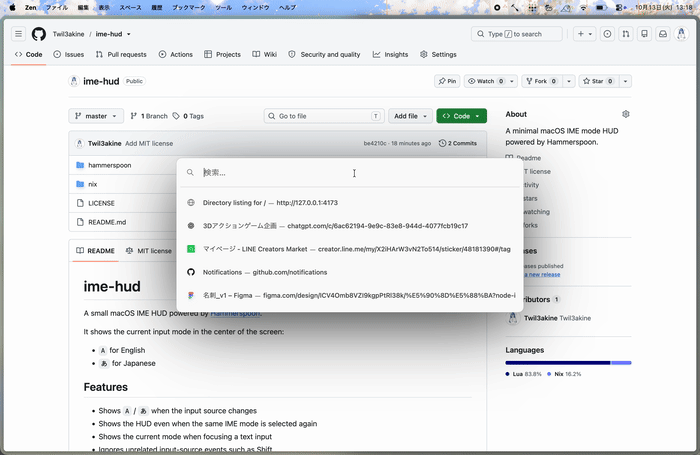

# ime-hud

A small macOS IME HUD powered by [Hammerspoon](https://www.hammerspoon.org/).

It shows the current input mode in the center of the screen:

- `A` for English
- `あ` for Japanese



## Features

- Shows `A` / `あ` when the input source changes
- Shows the HUD even when the same IME mode is selected again
- Shows the current mode when focusing a text input
- Ignores unrelated input-source events such as Shift
- Uses a fixed-size HUD, so `A` and `あ` are displayed consistently
- Works well with Karabiner-Elements configurations that send `japanese_eisuu` / `japanese_kana`

## Requirements

- macOS
- [Hammerspoon](https://www.hammerspoon.org/)
- Accessibility permission for Hammerspoon

The included Nix package currently uses Hammerspoon 1.1.1.

## Installation

Clone the repository:

```sh
git clone https://github.com/twil3akine/ime-hud.git
cd ime-hud
```

Copy the Hammerspoon configuration:

```sh
mkdir -p ~/.hammerspoon
cp hammerspoon/init.lua ~/.hammerspoon/init.lua
```

Then reload the Hammerspoon configuration.

## Nix / nix-darwin

A Hammerspoon package definition is included in:

```text
nix/hammerspoon.nix
```

Load it from your nix-darwin configuration:

```nix
let
  hammerspoon = pkgs.callPackage ./nix/hammerspoon.nix { };
in
{
  environment.systemPackages = with pkgs; [
    hammerspoon
  ];
}
```

The Hammerspoon configuration itself can be managed with Home Manager:

```nix
home.file.".hammerspoon/init.lua".source = ./hammerspoon/init.lua;
```

Then rebuild your nix-darwin configuration as usual.

## Behavior

### Input source changes

```text
English  -> Japanese : あ
Japanese -> English  : A
```

Selecting the already-active mode also displays the HUD:

```text
English  -> English  : A
Japanese -> Japanese : あ
```

The latter behavior listens for the macOS Eisu/Kana key events. This is particularly useful when Karabiner-Elements maps another key, such as Command, to `japanese_eisuu` or `japanese_kana`.

### Text inputs

When a text field receives focus through a mouse click or Tab, ime-hud shows the currently active input mode.

Accessibility behavior differs between applications, so text-field detection may not work in every application.

## Configuration

HUD appearance can currently be adjusted directly in:

```text
hammerspoon/init.lua
```

For example:

```lua
local width = 140
local height = 140
```

controls the HUD size, while:

```lua
textSize = 72
```

controls the displayed character size.

## License

MIT
